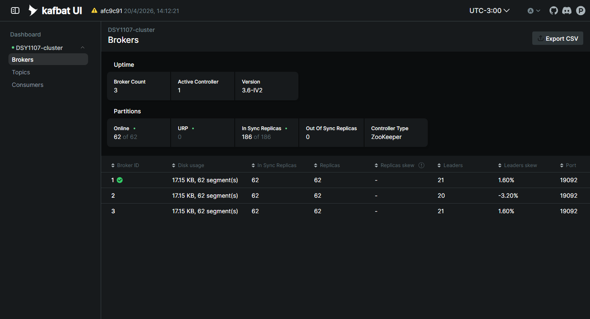
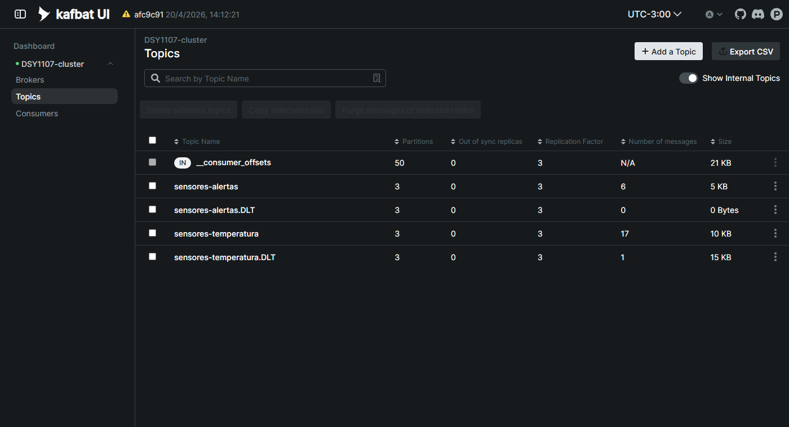
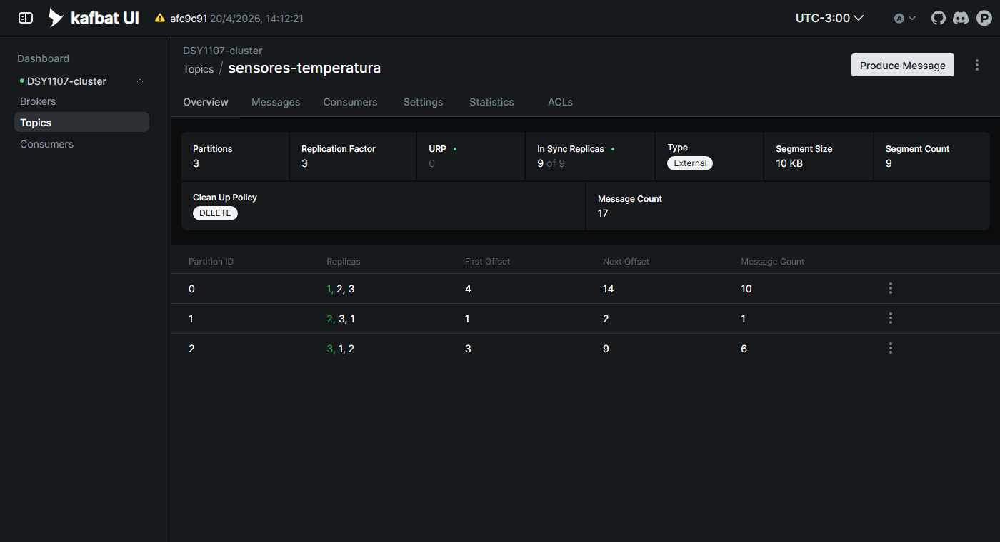
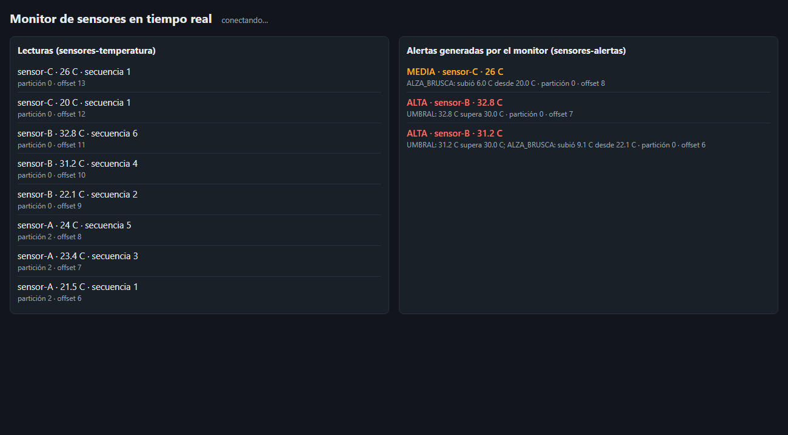
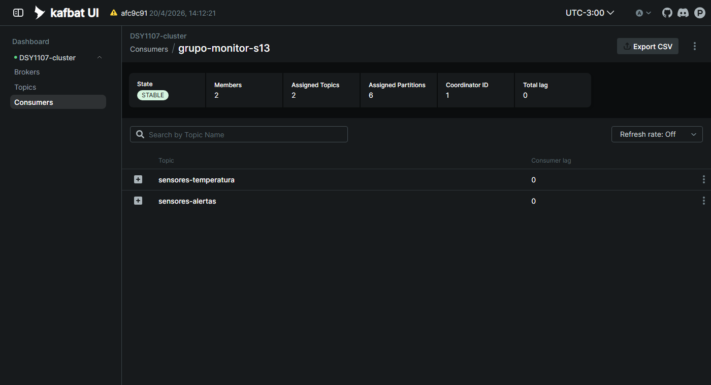

# Evidencias de pruebas

Resultados reales obtenidos con el clúster de 3 ZooKeeper + 3 brokers y los
servicios arrancados con el perfil `cluster`.

## 1. Topología del clúster

Salida completa en [`capturas/06-script-08-verificar-cluster.txt`](capturas/06-script-08-verificar-cluster.txt).

```
zookeeper1 -> Mode: follower
zookeeper2 -> Mode: follower
zookeeper3 -> Mode: leader
Brokers registrados en ZooKeeper (/brokers/ids): [1, 2, 3]
Controller elegido (/controller): {"brokerid":1, ...}
Particiones sub-replicadas: (vacío)
```



## 2. Tópicos: 3 particiones, RF3





Los líderes quedan repartidos (partición 0 en el broker 1, 1 en el 2 y 2 en el
3). Los servicios crean los tópicos con RF3 aunque arranquen antes del script 07.

## 3. Publicación y consumo con la clave `sensorId`

`kafka-lab/scripts/05_enviar_6_lecturas.ps1`:

```
{"sensorId":"sensor-A","particion":2,"offset":0}
{"sensorId":"sensor-B","particion":0,"offset":0}
{"sensorId":"sensor-A","particion":2,"offset":1}
{"sensorId":"sensor-B","particion":0,"offset":1}
{"sensorId":"sensor-A","particion":2,"offset":2}
{"sensorId":"sensor-B","particion":0,"offset":2}
```

Todas las lecturas de `sensor-A` caen en la partición 2 y las de `sensor-B` en
la 0, con offsets correlativos: la clave mantiene el orden por sensor.

## 4. Procesamiento reactivo y tiempo real

Alertas que publicó el monitor al reaccionar (las 6 lecturas anteriores más
`sensor-C` de 20.0 a 26.0 °C):

```
ALTA  sensor-B 31.2 | UMBRAL: 31.2 C supera 30.0 C; ALZA_BRUSCA: subió 9.1 C desde 22.1 C
ALTA  sensor-B 32.8 | UMBRAL: 32.8 C supera 30.0 C
MEDIA sensor-C 26.0 | ALZA_BRUSCA: subió 6.0 C desde 20.0 C
```

Un cliente conectado a `GET /api/monitor/stream` (`Content-Type:
text/event-stream`) recibió en vivo los 8 eventos `lectura` y los 3 eventos
`alerta`.



## 5. Consumer group, offsets y lag



`kafka-lab/scripts/06_verificar_grupo.ps1 -Grupo grupo-monitor-s13 -Cluster`:

```
TOPIC                PARTITION  CURRENT-OFFSET  LOG-END-OFFSET  LAG
sensores-temperatura 0          9               9               0
sensores-temperatura 1          2               2               0
sensores-temperatura 2          6               6               0
sensores-alertas     0          6               6               0
sensores-alertas     1          1               1               0
```

Lag 0 significa que el monitor procesó todo lo publicado. Con el monitor
detenido, el lag crece; al volver, retoma desde el último offset confirmado.

## 6. Reintentos y DLT

`kafka-lab/scripts/09_probar_dlt.ps1 -Cluster` publica una lectura de
`sensor-fallo`. El log del monitor muestra los intentos 1/3, 2/3 y 3/3, y el
mensaje termina en la DLT, en la misma partición:

```
Partition:1  Offset:0  sensor-fallo  {"sensorId":"sensor-fallo","temperatura":99.9,"unidad":"C","secuencia":999}
```

Esta prueba encontró un bug real: con Spring Kafka 3.3 el destino por defecto
era `sensores-temperatura-dlt`, que no existe, y el mensaje se perdía. Se
corrigió con un destino explícito `<topic>.DLT` y un test que lo fija.

## 7. Tolerancia a fallas

Con `zookeeper3` (leader) y `kafka3` detenidos a la vez:

```
zookeeper1 -> Mode: follower
zookeeper2 -> Mode: leader          ← nuevo leader elegido
publicar: {"sensorId":"sensor-C","particion":0,"offset":3}   ← se sigue publicando
sensores-temperatura  Partition: 2  Leader: 1  Replicas: 3,1,2  Isr: 1,2
```

El ISR baja a 2 (cumple `min.insync.replicas=2`) y el monitor siguió
consumiendo. Al volver a iniciar ambos nodos no quedaron particiones
sub-replicadas.

Recuperación tras un apagado brusco (`docker kill` de todo el clúster): los
brokers abortan una vez porque ZooKeeper aún tiene su registro anterior, se
reinician solos (`restart: unless-stopped`) y en unos 40 s vuelven `[1, 2, 3]`.

## 8. Seguridad de los administradores

```
GET http://localhost:8084/api/admin/kafka/topics   (sin token) → 401
```

`kafka-admin-api` y `rabbit-admin-api` exigen el JWT de Entra ID con scope
`Pedidos.Read` y rol `Admin`.

## 9. Compilación y tests

| Componente | Tests |
|---|---|
| pedidos-api | 49 |
| catalogo-api | 14 |
| rabbit-admin-api | 20 |
| ms-productor-sensores | 8 |
| ms-monitor-sensores | 20 |
| kafka-admin-api | 16 |
| Angular (`ng test`) | 2 |
| **Total** | **129, sin fallas** |

Los tests de Kafka no necesitan broker. Cubren las reglas de reacción, que la
alerta no duplique la lectura al reintentar, el destino de la DLT, el SSE, la
validación del DTO y las reglas del administrador.
