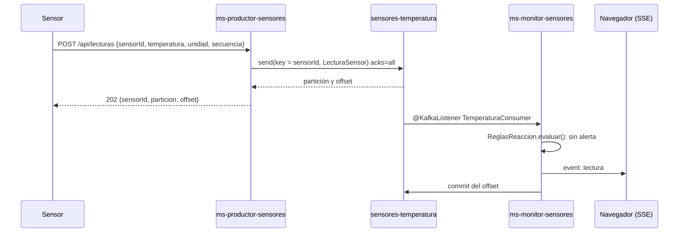
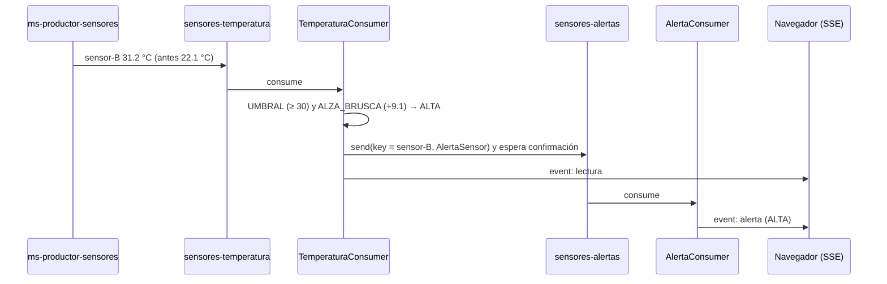
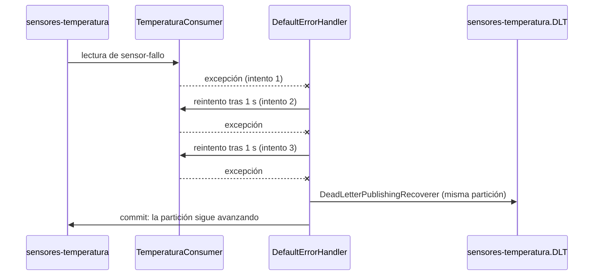

# Flujos de eventos

GitHub dibuja estos diagramas automáticamente. La vista general está en
[`arquitectura.png`](arquitectura.png).

## 1. Lectura normal (Kafka)



## 2. Lectura que dispara una alerta (procesamiento reactivo)



Con `sensor-C` de 20.0 a 26.0 °C solo se cumple `ALZA_BRUSCA` y la alerta sale
con severidad MEDIA.

## 3. Error de procesamiento: reintentos y DLT



Un mensaje que no se puede deserializar sigue el mismo camino gracias a
`ErrorHandlingDeserializer`. Si lo que falla es la publicación de la alerta, la
lectura no se guarda antes de reintentar, así no queda duplicada.

## 4. Pedido aceptado (RabbitMQ, flujo que se mantiene)

```mermaid
sequenceDiagram
    participant U as Angular (Operador)
    participant G as API Gateway (JWT)
    participant PA as pedidos-api
    participant CA as catalogo-api
    participant X as pedidos360.direct / topic
    participant Q as colas cocina / notificaciones

    U->>G: PUT /api/orders/{id}/status ACEPTADO
    G->>PA: token validado
    PA->>CA: descontar stock (reenvía el token)
    CA-->>PA: OK
    PA->>X: evento pedido.aceptado
    X->>Q: binding pedido.aceptado → cocina; pedido.# → notificaciones
    Q->>Q: consumer con ACK manual; si falla: .retry (5 s) ×3 → .dlq
```

## Comparación de manejo de errores

| | RabbitMQ (pedidos) | Kafka (sensores) |
|---|---|---|
| Reintento | Copia en `<dominio>.retry` con TTL 5 s y cabecera `x-intentos` | `DefaultErrorHandler` con `FixedBackOff(1000, 2)` |
| Intentos | 3 | 3 (1 + 2 reintentos) |
| Destino final | `pedidos360.<dominio>.dlq` vía DLX | `<topic>.DLT`, misma partición |
| Qué pasa con el original | `basicNack(requeue=false)` | Se confirma el offset y la partición sigue |
